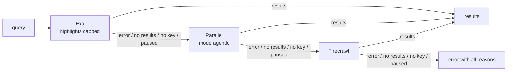

# hermes-search-chain

A [Hermes Agent](https://github.com/NousResearch/hermes-agent) plugin that makes `web_search` fall back across three search services: **Exa → Parallel → Firecrawl**.

Hermes uses exactly one search provider. If it fails, for example because the free quota is used up, the model gets an error, or Hermes' keyless rescue serves the call from anonymous free tiers. This plugin registers one provider, `search-chain`, that asks the next service when one fails, returns nothing, or has run out of quota.

It is the search counterpart of [hermes-extract-chain](https://github.com/Pressimize/hermes-extract-chain), which does the same for `web_extract`.

## How it works



- Each service is asked at most once per search; there are no retries.
- A service without a key is skipped.
- Every service is asked for at most 20 results; a result without an `http(s)` address is dropped.
- After **HTTP 402** (quota or budget used up) a service is skipped for 24 hours, after **HTTP 429** (rate limit) for one minute. Then it is asked again, so nothing has to be reset when a quota renews. Pauses live in memory only; restarting Hermes ends them.
- If no service returns results, the model gets one error with every reason, e.g. `search-chain: Exa: HTTP 402 NO_MORE_CREDITS (paused for another 17 h); Parallel: timeout; Firecrawl: no results`.

The model gets the same result format as from any Hermes search provider. It is not told which service answered; the log is (see *Check*).

## Why these three

In a comparison of seven search providers on 80 queries without an LLM (75 scored on whether the first five results contain the expected source or answer), Exa found 73, Parallel 72 and Firecrawl 65; the other four found 50 to 54. Exa and Parallel cannot be told apart on this data. Exa comes first because, with its highlights capped, it returns about half the text of Parallel and was faster inside Hermes, and it is the first to use up its smaller free allowance, after which the chain carries on with Parallel. Firecrawl comes last: it scored lowest of the three, and its small free allowance is shared with scraping.

Method, tables and the reasons for each choice: [docs/evaluation.md](docs/evaluation.md). Every query and per-query result is in [`data/`](data).

## Requirements

- Hermes Agent ≥ 0.21 (written against v0.21.6).
- API keys; a service without a key is skipped, at least one is needed:
  - [Exa](https://exa.ai): free plan with $10 of credits per month, about 1,400 searches at $7 per 1,000.
  - [Parallel](https://parallel.ai): the pricing page names 5,000 free requests per month.
  - [Firecrawl](https://firecrawl.dev): free plan with 1,000 credits per month, 2 credits per search of up to 10 results, 10 searches per minute.
- Network access to `api.exa.ai`, `api.parallel.ai` and `api.firecrawl.dev` (HTTPS; `HTTPS_PROXY` is honoured).

No extra Python packages: the plugin only uses `httpx`, which ships with Hermes.

## Installation

**Manual (recommended):** copy the directory `search_chain/` as `plugins/search-chain/` into your Hermes home.

| Setup | Target directory |
|---|---|
| Linux / macOS | `$HERMES_HOME/plugins/search-chain/`; the Hermes home is usually `~/.hermes` |
| Official Docker image | `/opt/data/plugins/search-chain/` (`/opt/data` is the mounted Hermes home) |
| Hermes Desktop (Windows), per profile | `%LOCALAPPDATA%\hermes\profiles\<profile>\plugins\search-chain\` |

```bash
git clone https://github.com/Pressimize/hermes-search-chain.git   # for an update: git -C hermes-search-chain pull --ff-only
target="${HERMES_HOME:-$HOME/.hermes}/plugins/search-chain"       # or the directory of your row in the table above
mkdir -p "$target" && cp -r hermes-search-chain/search_chain/. "$target/"
```

Then enable it in the profile's `config.yaml` (user plugins are opt-in) and select it:

```yaml
plugins:
  enabled:
    - search-chain           # add to your existing entries
web:
  search_backend: search-chain
  keyless_rescue: false      # required: otherwise Hermes silently replaces a failed chain
```

`web.keyless_rescue` also applies to `web_extract`. With it on, a search that fails at all three services is served from anonymous free tiers, and neither the model nor this plugin's log line shows it.

Put the keys into the profile's `.env`:

```bash
EXA_API_KEY=...
PARALLEL_API_KEY=...
FIRECRAWL_API_KEY=...
```

Restart Hermes (or the gateway).

**With Hermes' installer:**

```bash
hermes plugins install Pressimize/hermes-search-chain#search_chain --enable
```

It clones only the `search_chain` subdirectory, asks for the three keys and enables the plugin. The `web:` settings above are still needed. Enabling through Hermes' CLI also syncs Hermes' package environment; the manual route avoids that step.

**Check:** let the agent search for something. `logs/agent.log` in the Hermes home then shows a line per search:

```text
search-chain: exa=ok
search-chain: exa=http_402 parallel=ok
search-chain: exa=paused parallel=ok
```

When a pause starts, `logs/errors.log` gets a line such as `search-chain: exa paused for 86400 s (HTTP 402 NO_MORE_CREDITS)`.

## Settings

Two optional settings in the profile's `.env`:

```bash
SEARCH_CHAIN_EXA_HIGHLIGHT_CHARS=600   # default; 0 = Exa's own highlight length (about three times the text)
SEARCH_CHAIN_PARALLEL_API=beta         # default: the call Hermes makes; v1 = /v1/search in mode advanced
```

Exa returns excerpts ("highlights") per result. Capped at 600 characters, a search of five results is about 4,000 characters instead of 12,000, with no loss of hits or answers in the tests (design D3). Set `0` to switch the cap off.

Parallel is called on its beta endpoint in mode `agentic`, exactly as Hermes' built-in provider does. `v1` moves the stage to the GA endpoint `/v1/search` in mode `advanced`; see the FAQ.

## Validation

Unit tests without network cover every rule of the chain, the provider calls and the settings. An end-to-end test with a model (36 questions, four setups, 144 runs through Hermes' real tool path) had no failed run, and the intended stage served every search; with an invalid Exa key Parallel served, with invalid Exa and Parallel keys Firecrawl. Not verified: a really used-up quota (HTTP 402 and the 24-hour pause).

Setup, judging, all tables, limits and the external code reviews: [docs/validation.md](docs/validation.md). Questions, per-run results and answers: [`data/end-to-end/`](data/end-to-end).

## Update and uninstall

- **Update:** delete `plugins/search-chain/`, copy the new `search_chain/` in its place as in *Installation*, and restart Hermes. Do not run `cp -r search_chain` onto an existing `plugins/search-chain`: that puts the new copy one level deeper, into `plugins/search-chain/search_chain/`, and Hermes keeps loading the old files. After an install with `hermes plugins install`, use `hermes plugins update search-chain`. See [CHANGELOG.md](CHANGELOG.md).
- **Uninstall:**
  1. Delete `plugins/search-chain/`.
  2. Remove `search-chain` from `plugins.enabled`.
  3. Set `web.search_backend` back to your previous provider.
  4. Restart Hermes.

## Costs and quotas

The chain reacts to a service's reply; it does not know the remaining quota in advance. Whether a service answers HTTP 402 or charges a stored payment method when the free quota is used up depends on your account settings. For a hard cost cap, keep auto recharge off at Exa and Firecrawl and store no payment method you do not want charged.

Count which service answered:

```bash
grep -o "search-chain: .*" logs/agent.log | grep -o "[a-z]*=ok" | sort | uniq -c
```

## Limitations

- **Fixed providers and order.**
- **No results is an error.** If no service finds anything, the model gets an error with `no results` instead of an empty list, because Hermes caches every successful result for `web.cache_ttl_minutes` (default 20).
- **Different result lengths.** Exa (capped) returns about 4,000 characters per search, Parallel about 8,200, Firecrawl about 3,900. A title is cut at 300 characters and a description at 16,000; a description from Firecrawl is cut at 3,000. In the comparison 26 of Firecrawl's 400 descriptions (6.5 %) were longer than that; cutting them changed no verdict.
- **At most 20 results per search.** Hermes lets the model ask for up to 100; every service is asked for at most 20, because Exa bills each result above 10 extra.
- **Result texts are third-party content.** Titles and descriptions reach the model as the services send them, apart from the length bounds above. Hermes marks web search results as untrusted data; the plugin does not filter them.
- **Parallel's quota replies are not documented.** The chain moves on after any failure; only the 24-hour pause depends on the status code being 402.
- **After a restart** the first search asks every service again, including one with a used-up quota. Without a restart, a renewed or topped-up quota is used only after the 24-hour pause.
- **Privacy.** Every query is sent to Exa, and possibly to Parallel and Firecrawl.
- **Timeouts** are 10 s (Exa) and 15 s (Parallel, Firecrawl) for each phase of a request (connect, send, wait for the reply), not for the search as a whole. A search in which every service hangs takes about 40 s. It takes longer when a service is slow in several phases or sends its reply in a trickle; Hermes ends a tool call after 420 s by default.

## FAQ

**Why not reuse Hermes' built-in Exa, Parallel and Firecrawl providers?**
They need vendor SDKs that Hermes installs on first use. Calling the REST APIs directly needs nothing extra, gives exact status codes, and reaches Exa's highlight cap, which the built-in provider does not expose.

**Which Parallel endpoint, and why?**
The beta endpoint in mode `agentic`, the call Hermes 0.21.6 makes; it was never worse than `/v1/search` in two tests (design D2). If Parallel switches the beta endpoint off, set `SEARCH_CHAIN_PARALLEL_API=v1`.

**Does it merge or re-rank results from several services?**
No. A simulation on the comparison data showed no measurable gain from merging; all results of one search come from one service.

**Does it do page extraction?**
No. `web.extract_backend` is unaffected; see [hermes-extract-chain](https://github.com/Pressimize/hermes-extract-chain).

## Development

```bash
uv sync                                   # Python >= 3.11, httpx as in Hermes
uv run ruff check && uv run ruff format --check
uv run pytest
uv run python scripts/recompute.py         # recomputes the tables of the documents; the tests run it
```

| Path | Content |
|---|---|
| `search_chain/` | The plugin: `provider.py` (Hermes interface, chain, pauses), `engines.py` (REST clients) |
| `tests/` | Unit tests without network (`httpx.MockTransport`; Hermes is stubbed in `conftest.py`) |
| `scripts/recompute.py` | Recomputes the tables of the evaluation and validation documents from the CSV files in `data/` |
| `scripts/live_check.py` | Calls Hermes' real `web_search` path in a profile, without an LLM and with rate limiting; can break keys to force the fallback |
| `docs/` | [evaluation](docs/evaluation.md) (provider choice, test method, results), [design](docs/design.md) (requirements and decisions with their reasons), [validation](docs/validation.md) (tests, reviews, end-to-end test with a model), [reviews](docs/reviews) (points settled in external reviews) |
| `data/` | Test data as CSV: queries, per-query results of both comparison runs, questions and answers of the end-to-end test ([description](data/README.md)) |
| `.github/workflows/ci.yml` | CI on pull requests and pushes to `main`: ruff and pytest on Python 3.11 and 3.14 |

`pyproject.toml` only configures the tooling and sits at the repository root because Hermes treats a plugin directory with a `pyproject.toml` as a package-manager member.

## Authors

- [Pressimize](https://github.com/Pressimize): idea, requirements and decisions.
- Claude, Anthropic's AI model, working in Claude Code: design, code, tests, evaluation and documentation.

## License

[MIT](LICENSE)
